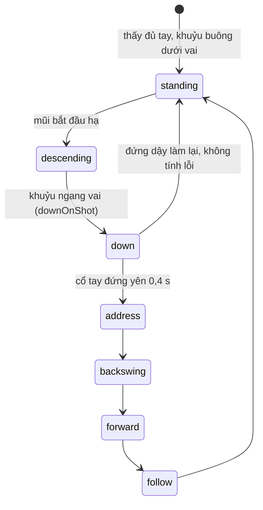

# Vào bộ: soi quá trình vào tư thế bằng Stance Check

Research ngày 2026-10-21, 09:11–09:45 (Asia/Saigon). Nhánh `feat/pool-editor`. Report này nối tiếp `research-261020-1115-dung-bo-tay-sau-pose.md` và không nhắc lại phần chuẩn cú đẩy cơ hay bảng so sánh engine nhận dáng ở đó.

## Kết luận

Cơ chế của Good-GYM đã vào source từ commit `830bb4f` (2026-10-20). `StrokeTracker` trong `modules/pool-table/ios/Pose/PoseStroke.swift` dùng đúng mẫu "bộ ba khớp, ngưỡng góc, state machine", và đã kiểm "tay sau có thẳng không" (cẳng tay dọc trong 10°) lúc address và lúc chạm. Không cần port thêm gì từ Good-GYM.

Phần còn trống là chính quá trình vào bộ. Từ lúc đứng sau bi tới lúc address, tracker chỉ chờ ở pha `settling` mà không đo gì. Em khuyến nghị thêm pha hạ người vào chính state machine này, vẫn dùng camera bên hông, và đo hai thứ có nguồn: cơ có đứng yên trong lúc ngực hạ xuống không (Nolan), và đã xuống rồi có chỉnh lớn không (Nolan, Dr. Dave).

Phần "đi vào đúng line" là lõi của vào bộ theo cả hai nguồn, nhưng camera bên không thấy được vì lệch line là lệch theo chiều sâu ảnh. Muốn đo phải đặt máy sau lưng, và hướng đó dựa vào giả định Vision nhận đúng bên trái phải khi nhìn từ sau. Giả định này chưa ai đo.

Cả hai hướng chung một rủi ro chưa gỡ: ngưỡng hiện tại chưa chạy trên clip thật nào. Repo không có clip, màn Stance Check còn ghi "Thresholds are a first guess, not calibrated yet". Việc rẻ nhất, và chặn mọi việc sau, là quay clip rồi chạy `scripts/pose-harness`.

## 1. Source đang có gì

Phần này đã kiểm bằng cách đọc code.

| Phần của Good-GYM | Đã có trong source |
|---|---|
| Góc từ 3 khớp | `forearm`: khuỷu tới cổ tay so với phương trọng lực. `upper`: vai tới khuỷu. `kneeAngle`: hông, gối, cổ chân |
| Ngưỡng trong `exercises.json` | `PoseLimits`: cẳng tay 10°, bắp tay 6°, đầu 3 cm, dừng sau 0,2 s, máy ngả tối đa 12° |
| State machine đếm rep | `searching`, `settling`, `address`, `backswing`, `forward`, `follow`. Cờ `awaitingRise` bắt người chơi đứng dậy mới nhận cú mới, giữ vai trò của `min_rep_time` |
| Làm mượt bằng median | Median trong cửa sổ đứng yên 0,4 s lúc address |
| Báo kết quả | `PoseVoice`: giọng Việt, Anh hoặc beep, mỗi cú một lỗi |

Ba lỗi dễ mắc khi port mà em nêu hôm qua đều đã được xử lý. `PoseFrame` đổi toạ độ chuẩn hoá về pixel. `PoseOrientation` xoay ảnh theo trọng lực của CoreMotion. Khớp có confidence dưới 0,4 thì bị bỏ.

Còn thiếu ba thứ: clip thật để hiệu chuẩn, phép đo trong pha `settling`, và `backKnee` đo rồi nhưng không bao giờ thành lỗi.

## 2. Chuẩn vào bộ, theo nguồn

Em hiểu "vào bộ" là quá trình từ lúc đứng sau bi tới lúc address xong. Em không tìm được nguồn tiếng Việt nào định nghĩa từ này. Nếu anh dùng theo nghĩa khác thì phần dưới phải sửa.

| Mốc | Chuẩn | Nguồn | Độ chắc |
|---|---|---|---|
| Ngắm từ lúc còn đứng | "90% of the shot aim is achieved when you get behind the shot". Xuống rồi chỉ chỉnh nốt 10% | Nolan tr. 25 | Chắc, đọc bản gốc |
| Đi vào trên line | Đứng lùi khỏi bàn, đặt cơ lên line ngay trong lúc đi vào. "I teach my players to walk into the shot properly by approaching the shot on the line of aim" | Nolan tr. 25, 28 | Chắc |
| Thứ tự chân | Đứng sau cơ, đặt chân sau trên hoặc sát line trước, rồi bước chân trước sang ngang, đầu giữ trên line suốt | Dr. Dave BD 08/2020 | Trung bình: chỉ đọc qua snippet, bản gốc chặn truy cập |
| Hạ người | Hạ thẳng xuống, vision center giữ trên line | Dr. Dave BD 02/2024 | Trung bình, lý do như trên |
| Cơ trước, ngực sau | Đầu cơ đặt sát bi cái rồi mới hạ người. "Do not move the cue until your chest touches your cue. You must bring your chest to the cue and not your cue to the chest" | Nolan tr. 25, 30 | Chắc |
| Chân trước | Một phần chân trước nằm trên line, hai chân rộng tối thiểu bằng vai | Nolan tr. 25, 28 | Chắc |
| Xuống rồi thấy sai | Chỉnh nhỏ thì được. Chỉnh lớn thì đứng dậy làm lại từ đầu | Nolan tr. 25, Dr. Dave FAQ | Nolan chắc, Dr. Dave trung bình |
| Tay sau lúc xong | Cẳng tay dọc, "vertical address position" | Nolan tr. 26, 30 | Chắc, app đã kiểm |
| Kiểu đứng | Không ép theo sách, tuỳ dáng người | Dr. Dave, snippet | Trung bình |

Không nguồn nào cho số: cổ tay dịch bao nhiêu thì vẫn tính là "cơ đứng yên", chỉnh bao lâu thì thành "chỉnh lớn". Giống phần cú đẩy, ngưỡng phải lấy từ clip.

Forum AZB (nguồn yếu) có một dấu hiệu nhận lỗi kéo cơ vào ngực: vai nằm ngay trên line. Em chưa thấy coach nào viết điều này ở tài liệu chính thức.

## 3. Đo được gì, từ góc máy nào

| Kiểm | Camera bên hông (setup hiện tại) | Camera sau lưng, đặt trên line |
|---|---|---|
| V1. Cơ đứng yên khi ngực hạ | Được. Cổ tay cầm cơ phải gần như đứng yên trong lúc mũi và vai hạ xuống | Một phần |
| V2. Xuống rồi chỉnh lớn | Được. Đo thời gian và số lần cổ tay hoặc bắp tay dịch quá ngưỡng, từ lúc xuống tới lúc address đứng yên | Được |
| V3. Hạ thấp tới đâu, góc thân | Được, chỉ báo số vì không có chuẩn | Không |
| V4. Chân sau thẳng | Được nếu bàn không che chân, `backKnee` đã có. Nguồn yếu nên chỉ báo số | Không |
| V5. Đi vào và hạ người trên line | Không | Được, nếu máy đặt đúng trên line và Vision giữ được đầu khi nhìn từ sau |
| V6. Chân rộng bằng vai | Không | Thô, vì hai chân ở hai độ sâu khác nhau nên phối cảnh làm lệch tỉ lệ |
| V7. Khuỷu chìa ra hay khép vào | Không | Được, nhưng Callan nói không có chuẩn nên chỉ báo độ lặp giữa các cú |

V1 là suy luận của em từ câu của Nolan, chưa kiểm trên clip: nếu ngực hạ xuống tìm cơ thì tay cầm cơ đứng yên, còn nếu kéo cơ về ngực thì cổ tay phải dịch lên và lùi về sau.

V5 có một rủi ro riêng. Nhìn từ sau lưng thì Vision mất mũi và mắt, chỉ còn tai, cổ, vai. Nhầm bên trái phải là lỗi đã có tên trong tài liệu pose 2D ("confusion of body sides"). Em chưa thấy số đo nào riêng cho Vision.

## 4. Hướng làm

Ba pha `standing`, `descending`, `down` là phần thêm mới, thay cho pha `settling` hiện tại. Từ `address` trở đi giữ nguyên code. V1 đo trong `descending`, V2 đo trong `down`.

**A. Thêm pha vào bộ vào `StrokeTracker`, camera bên hông (khuyến nghị).** Đo V1 và V2, báo số V3 và V4. Không thêm màn, không đổi cách đặt máy, vì màn Stance Check đã dặn đặt máy cách 2–3 m và giữ cả người trong khung. Mỗi cú vẫn chỉ báo một lỗi nặng nhất, lỗi vào bộ xếp sau lỗi cẳng tay. Hướng này dựa nhất vào giả định: từ bên hông, Vision giữ được cổ tay và vai trong lúc người hạ xuống. Nó vỡ đầu tiên khi người chơi bước vào từ phía máy và che mất tay cơ, hoặc khi hai tay cùng cầm cơ lúc đi vào làm Vision nhận nhầm cổ tay.

**B. Thêm chế độ camera sau lưng.** Đo được V5, thứ mà Nolan và Dr. Dave coi là cốt lõi của vào bộ. Hướng này dựa nhất vào giả định Vision giữ đúng tai, cổ, vai và đúng bên trái phải khi nhìn từ sau. Nó vỡ đầu tiên ở chính giả định đó. Thêm nữa, người dùng đặt máy lệch line vài cm thì mốc so sánh lệch theo. Hướng này cần thêm một lựa chọn góc máy trên màn Stance Check, tức là đụng UI, nên phải hỏi anh trước theo quy ước hiện tại.

**C. Hai máy cùng lúc.** Ghép A với B, phải đồng bộ thời gian hai máy. Chưa đáng làm khi chưa biết A và B có chạy được riêng không.

Thứ tự em đề xuất: làm A trước, vì không đụng UI và rủi ro của nó trùng với rủi ro phần đang có. Chỉ làm B khi clip quay từ sau lưng qua được tiêu chí ở mục 5.

**Better approaches:** không port `exercises.json` hay bộ đếm của Good-GYM. `StrokeTracker` đã đi xa hơn Good-GYM ở ba chỗ: đo góc so với trọng lực thay vì góc giữa hai đoạn xương, chặn đo khi máy ngả quá 12°, và tách pha thay vì chỉ dùng hai ngưỡng. Thêm pha vào đây rẻ hơn dựng song song một bộ thứ hai.

## 5. Bước kế

1. Anh quay clip. Mỗi clip gồm cả vào bộ lẫn cú đánh, giữa các cú thì đứng dậy hẳn.
   - Bên hông, đặt máy như màn Stance Check dặn: 3 lần vào bộ đúng, 2 lần cố ý kéo cơ vào ngực, 2 lần xuống rồi chỉnh lớn, 1 lần xuống rồi đứng dậy làm lại.
   - Sau lưng, máy đặt trên đường kéo dài của line, ngang tầm vai: 3 lần đúng, 2 lần cố ý đi vào lệch từ bên.
2. Chạy `sh scripts/pose-harness/run.sh clip.mov --csv out.csv` cho từng clip. Harness đã có sẵn và chạy đúng `PoseFrame` và `StrokeTracker` của app. Cùng bộ clip này dùng luôn để hiệu chuẩn ngưỡng cú đẩy, việc còn treo từ report hôm qua.
3. Tiêu chí em đề xuất, chưa có nguồn, chỉ là mức đủ dùng:
   - Bên hông: cổ tay, khuỷu, vai có confidence từ 0,4 trở lên ở ít nhất 90% số khung trong lúc hạ người. Độ dịch cổ tay của clip kéo cơ vào ngực tách rõ khỏi clip đúng.
   - Sau lưng: cổ và hai vai có confidence từ 0,4 trở lên ở ít nhất 90% số khung, không khung nào đảo trái phải. Clip đi lệch tách được khỏi clip đúng.
4. Bên hông qua bước 3 thì lên plan cho A. Sau lưng trượt thì bỏ B và ghi lại số đo để khỏi thử lại.

## Brainstorm contract

- **Outcome:** biết vào bộ cần kiểm những gì, cái nào đo được bằng Stance Check hiện có, cái nào cần góc máy khác, kèm một hướng làm có thứ tự.
- **Constraints:** Expo 57, iOS tối thiểu 16.4, Vision 2D, module Swift `modules/pool-table`. Không thiết kế lại UI. Không thêm phụ thuộc.
- **Non-goals:** không viết code trong lượt này. Không làm app gym riêng. Không đo độ thẳng của đầu cơ, việc đó cần cảm biến gắn cơ.
- **Acceptance:** report có chuẩn kèm nguồn, bảng đo được hay không theo từng góc máy, hướng khuyến nghị kèm điều kiện vỡ, và bước kế kiểm được bằng harness có sẵn.

## Nguồn

- PJ Nolan, EBSA Erasmus project, đọc bản gốc (tr. 25 The Approach, tr. 26 grip, tr. 28 stance, tr. 30 cue action): https://ec.europa.eu/programmes/erasmus-plus/project-result-content/3bc195e6-c654-49bc-b7fa-59a742076146/Erasmus%20Bulgaria%20EBSA%20Project%20Final%20Draft%206-4-2018.pdf
- Dr. Dave, BD 08/2020, pre-stance routine (chỉ snippet): https://billiards.colostate.edu/bd_articles/2020/aug20.pdf
- Dr. Dave, BD 02/2024, hạ người giữ vision center (chỉ snippet): https://billiards.colostate.edu/bd_articles/2024/feb24.pdf
- Dr. Dave, FAQ pre-shot routine best practices (chỉ snippet): https://drdavepoolinfo.com/FAQ/pre-shot-routine/best-practices/
- Forum AZB về chest contact và kéo cơ vào ngực (nguồn yếu): https://forums.azbilliards.com/goto/post?id=5078812 , https://forums.azbilliards.com/goto/post?id=5078960 , https://forums.azbilliards.com/goto/post?id=7448377
- Frank Callan, fcsnooker, khuỷu không có chuẩn cứng: https://www.fcsnooker.co.uk/coaching/basics/bridge_arm_and_cue_arm/bridge_arm_and_cue_arm.htm
- Confusion of body sides trong pose 2D: https://fount.aucegypt.edu/etds/684
- Good-GYM, đọc `exercise_counters.py` và `data/exercises.json` ngày 2026-10-21: https://github.com/yo-WASSUP/Good-GYM

## Câu hỏi còn mở

1. "Vào bộ" có đúng là từ lúc đứng sau bi tới lúc address không, hay anh tính cả cú đánh?
2. Anh có muốn hướng B không? Nó thêm một lựa chọn góc máy trên màn Stance Check.
3. Lỗi vào bộ nên báo bằng giọng ngay lúc address, hay gộp vào báo cáo sau cú?
