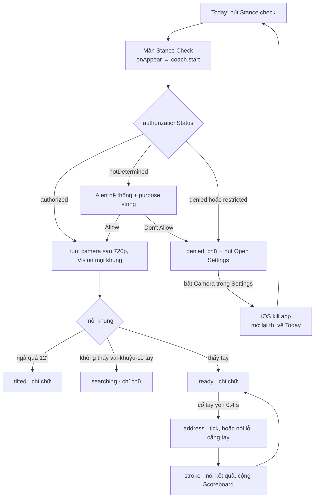

# Hành trình người dùng của Stance Check (soi tay sau)

Ngày: 2026-10-21 09:26. Phạm vi là toàn bộ đường đi của người chơi, từ lúc bấm nút trên Today đến lúc rời màn: hỏi quyền camera, đặt máy, soi, nghe phản hồi, và các trường hợp vỡ giữa chừng. Phần kỹ thuật bida nằm ở hai report trước: `research-261020-1115-dung-bo-tay-sau-pose.md` và `research-261021-0911-vao-bo-pose.md`.

Cách làm: em đọc `src/app/stance.tsx`, `modules/pool-table/ios/Pose/PoseCoach.swift`, `PoseCoachView.swift`, `PoseVoice.swift`, `modules/pool-table/src/PoseCoachView.tsx`, `app.json` và commit `830bb4f`, rồi đối chiếu với tài liệu Apple và forum. Mỗi nhận định có gắn nhãn: **(code)** là đã đọc trong source, **(Apple)** là tài liệu chính thức, **(forum)** là báo cáo của dev khác, **(suy đoán)** là chưa kiểm.

## Kết luận

Luồng chính chạy đúng. Hỏi quyền đúng chỗ, purpose string đạt chuẩn HIG, từ chối thì có nút Open Settings, màn hình không tắt khi đang soi, rời màn thì camera tắt sạch.

Lỗ lớn nhất không nằm ở chỗ xin quyền. Nó nằm ở chỗ **người chơi đứng cách máy 2–3 m mà máy im lặng**. Ba trạng thái setup (`tilted`, `searching`, `ready`) chỉ hiện bằng chữ cỡ callout. Giọng chỉ lên tiếng khi vào address hoặc xong cú **(code)**. Máy không thấy tay thì không có gì xảy ra cả, và người chơi không phân biệt được "máy không thấy mình" với "app hỏng".

Cùng kiểu lỗi đó (hỏng mà im) còn ở bốn chỗ khác: sau cuộc gọi audio session không được bật lại, nóng máy đến mức hệ thống ngắt camera, máy không có giọng tiếng Việt nên âm thầm chuyển sang bíp, và mục Head hiện "0cm" khi thực ra không đo được.

Đề xuất 20%: nói thành tiếng khi đổi trạng thái setup, bật lại audio session khi app quay lại, và hạ fps khi máy nóng. Ba việc này đều nằm trong native, không đụng UI. Những phần cố tình bỏ được ghi ở mục 4.

## 1. Luồng hiện tại

Các nút "chỉ chữ" là những lúc người chơi ở xa không nhận được gì.

## 2. Từng chặng

### 2.1 Vào màn

- **(code)** Today có `GhostButton` "Stance check" và `router.push("/stance")`. Không có giới thiệu hay first-run, bấm là vào thẳng màn camera.
- **(code)** Tay cơ mặc định là `right`, giọng mặc định là `vi`, cả hai nằm trong `useState` nên mỗi lần mở màn đều về mặc định. Người thuận tay trái phải đổi lại mỗi buổi, và đổi tay thì xoá danh sách cú (`setStrokes([])`).
- Đề xuất: nhớ tay cơ và chế độ giọng bằng storage app đang dùng. Việc này không đổi UI.

### 2.2 Hỏi quyền lần đầu

- **(code)** `onAppear` gọi `coach.start()`, `start()` gọi `AVCaptureDevice.requestAccess` ngay. Alert hệ thống bật lên trên một khung đen, đè lên dòng "Starting camera…". Tip đặt máy nằm dưới khung camera 3:4 nên lúc này người chơi chưa thấy.
- **(Apple, HIG Privacy)** HIG viết: *"Ideally, wait to request permission until people actually use an app feature that requires access."* Bấm "Stance check" chính là dùng tính năng, nên hỏi ở đây là đúng.
- **(Apple)** Purpose string hiện tại là *"Stance Check uses the camera to watch your cue arm from the side and tell you how each stroke went. Video stays on your phone."* Câu này chủ động, nói rõ dùng để làm gì, kết thúc bằng dấu chấm, khớp hướng dẫn *"brief, complete sentence that's straightforward, specific"*.
- **(Apple)** Nếu thêm màn giải thích trước alert thì HIG đặt luật chặt: chỉ một nút, nhãn "Continue" hoặc "Next", không được ghi "Allow", không có nút đóng hay huỷ (*"don't provide a way for people to leave the screen or window without viewing the system alert"*).
- Đề xuất: **không thêm màn pre-alert.** Ngữ cảnh đã đủ, purpose string đã tốt, và thêm màn là UI mới. Alert chỉ hiện một lần trong đời app, nên chỗ đáng đầu tư là đường từ chối ở mục 2.3.

### 2.3 Từ chối, bị hạn chế, bật lại

| Tình huống | Người chơi thấy gì | Đánh giá |
|---|---|---|
| Lần đầu, bấm Allow | Camera chạy, "Looking for your cue arm…" **(code)** | Đúng |
| Lần đầu, bấm Don't Allow | "Camera access is off." cùng nút Open Settings **(code)** | Đúng, nhưng câu chữ không nói phải làm gì sau đó |
| Mở lại màn khi đang denied | Hiện denied ngay, không có alert **(code)** | Đúng, vì iOS không cho hỏi lại |
| `restricted` (Screen Time, MDM) | Giống denied, có nút Open Settings **(code)** | Nút vô dụng vì người chơi không tự bật được. Hiếm gặp |
| Vào Settings bật Camera rồi quay lại | iOS kill app (signal 9), app mở lại từ Today **(forum, Apple DTS gọi là expected behaviour)** | Người chơi phải tự bấm Stance check lần nữa và không ai báo trước |
| Đang dùng, vào Settings tắt Camera | App bị kill tương tự **(forum)** | Chấp nhận được |

- **(code)** `_layout.tsx` chỉ có `initialRouteName: '(tabs)'`, không lưu navigation state, nên sau khi bị kill app về Today.
- Đề xuất: sửa câu chữ của trạng thái denied, ví dụ "Camera đang tắt. Bật Camera trong Settings, app sẽ khởi động lại, rồi mở lại Stance check." Không cần khôi phục route, vì chi phí khá cao so với lợi ích một lần.

### 2.4 Đặt máy và khung hình

- **(code)** Phần Phone placement có ba tip: dựng dọc trên chân máy phía tay cơ ngang khuỷu, cách 2–3 m vuông góc đường cú, thấy cả người. Tip nằm dưới Scoreboard nên phải cuộn mới thấy.
- **(code)** Chỉ có một cổng kiểm là độ ngả trước sau (`asin(|g.z|) > 12°`). Độ xoay ngang không cần kiểm vì `down` lấy theo trọng lực. App không kiểm máy có đứng yên hay không, nên cầm tay thì độ rung của máy bị tính thành chuyển động của cổ tay.
- **(suy đoán, tính tay)** Ở chế độ dọc, chiều ngang của khung 16:9 trên camera wide chỉ khoảng 41°. Ở 2 m khung phủ ngang khoảng 1,5 m, ở 2,5 m khoảng 1,9 m, ở 3 m khoảng 2,2 m. Từ cổ chân sau đến đầu khi cúi vào cú đã khoảng 1,2–1,4 m, nên đặt máy ở 2 m rất dễ bị cắt cổ chân hoặc đầu. Cần một clip thử ở ba khoảng cách để chốt lại tip thành "2,5–3 m".
- **(code)** `app.json` để `"orientation": "default"`, trong khi preview khoá xoay dọc qua `lockPortrait`. Nếu người chơi gắn máy nằm ngang lên chân máy thì preview có thể bị lệch 90° **(suy đoán, chưa thử trên máy)**. Vision vẫn chạy đúng vì hướng lấy theo trọng lực.
- **(Apple, Action & Vision sample)** App mẫu của Apple không có nút Start: *"The user doesn't have to touch the screen at all."* Nó tự chuyển trạng thái khi thấy máy đứng yên. Stance Check cũng không có nút Start, nên cái còn thiếu chỉ là phản hồi.

### 2.5 Đang soi

- **(code)** `searching` nghĩa là không thấy đủ vai, khuỷu, cổ tay. `ready` nghĩa là thấy tay nhưng tracker còn ở `searching` hoặc `settling`. `address` là khi cổ tay đứng yên. `stroke` là từ backswing đến follow-through. Status gửi lên JS tối đa 5 lần một giây và chỉ khi có đổi.
- **(code)** `ready` chỉ đòi tay, không đòi mũi. Khi không thấy mũi, `headLift` là `nil` và lỗi đầu bị bỏ qua, nhưng Scoreboard lại hiện `Math.round(last.headLift ?? 0)` thành **"0cm"**. Người chơi đọc ra là đầu giữ rất tốt trong khi thực tế không đo được.
- **(code)** `PoseFrame` chọn người có cánh tay tin cậy nhất. Trong quán, người khác đi ngang phía sau có thể bị bắt nhầm giữa cú **(suy đoán về tần suất)**.
- Đề xuất: Head hiện "–" khi `headLift` là nil. Đây là sửa một dòng, không đổi bố cục.

### 2.6 Phản hồi

- **(code)** Audio session dùng `.playback` + `.mixWithOthers`: vẫn kêu khi gạt im lặng và không cắt nhạc của người chơi. Đây là lựa chọn đúng cho quán bida.
- **(code)** Address đúng thì bíp cao, address lệch thì nói lỗi cẳng tay, xong cú thì nói kết quả. **Không có tiếng nào cho `searching`, `tilted`, `ready`.**
- **(code)** Chọn Tiếng Việt mà máy không có giọng `vi-VN` thì `AVSpeechSynthesisVoice(language:)` trả nil, code lặng lẽ chuyển sang tick/buzz. Người chơi chọn "Tiếng Việt" mà chỉ nghe bíp, và không có dòng nào giải thích.
- **(forum)** Chưa tìm được nguồn xác nhận giọng `vi-VN` có sẵn mặc định. Có báo cáo rằng từ iOS 18.6/26 một số giọng mặc định đã bị gỡ khỏi OS. Cần kiểm trên máy thật bằng `AVSpeechSynthesisVoice.speechVoices()`.
- **(Pattern)** True Pose quảng cáo TTS cues để người tập không phải nhìn màn hình. FitCoach hướng dẫn "step back until the full body is visible". VisionFit có đếm ngược để người tập lùi ra trước khi khoá tư thế. Điểm chung là có phản hồi bằng tiếng ngay trong lúc setup.
- Đề xuất chính: thêm câu nói ngắn khi trạng thái setup đổi và giữ đủ lâu. Ví dụ: "Đã thấy tay" khi từ `searching` sang `ready` giữ ≥1 s, "Không thấy tay" khi mất tay ≥2 s lúc chưa address, "Máy bị nghiêng" khi `tilted` ≥1 s. Ở chế độ Beep thì dùng một tông riêng. Mỗi câu chỉ nói một lần cho đến khi trạng thái đổi lại. Phần này nằm hết trong `PoseVoice` và `PoseCoach`, ước khoảng 30–40 dòng, không đụng UI.
- Đề xuất phụ: khi mở màn mà thiếu giọng `vi-VN` thì status ghi thêm một dòng "Máy chưa có giọng tiếng Việt, đang dùng bíp".

### 2.7 Gián đoạn

| Sự kiện | Hệ thống làm gì | Code xử lý chưa | Hậu quả |
|---|---|---|---|
| Ra Home, mở Control Center, đọc tin nhắn | Session bị ngắt với lý do `videoDeviceNotAvailableInBackground` và tự chạy lại khi quay về **(Apple enum, forum)** | Không có observer **(code)**. SwiftUI `onDisappear` không chạy khi vào background **(suy đoán)**, nên tracker giữ trạng thái cũ | Ổn. Có thể có một cú ảo nếu quay lại đúng lúc đang address **(suy đoán)** |
| Cuộc gọi đến | Audio session bị ngắt. Apple khuyên bật lại khi hết ngắt, nhưng **sự kiện "ended" không đảm bảo luôn đến** **(Apple, forum)** | Không xử lý, chỉ `setActive(true)` một lần trong `start()` **(code)** | Có thể im lặng tới hết buổi **(suy đoán cho AVSpeechSynthesizer, cần thử trên máy)** |
| Nóng máy | Ở mức `shutdown`, *"the capture session becomes interrupted until the pressured state abates"*. Apple khuyên hạ `activeVideoMinFrameDuration` **(Apple)** | Không theo dõi `systemPressureState`, Vision chạy mọi khung 30 fps, màn hình luôn sáng **(code)** | Preview đen, không tiếng, không thông báo. Rủi ro cao hơn trong quán nóng hoặc buổi tập 30–60 phút |
| App khác chiếm camera | Lý do `videoDeviceInUseByAnotherClient` **(Apple)** | Không xử lý | Kẹt ở "Starting camera…". Hiếm gặp |
| Media services reset | Session dừng, phải dựng lại **(Apple, forum)** | Không xử lý | Hiếm gặp |

- **(forum)** Một dev đo body pose khoảng 40 ms/khung trên iPhone 11 (2021). Với `alwaysDiscardsLateVideoFrames` thì máy cũ sẽ tự rớt khung. Ngưỡng của tracker tính theo timestamp nên logic không sai, chỉ thưa mẫu hơn.
- Đề xuất:
  1. Bật lại audio session khi nhận `UIApplication.didBecomeActiveNotification` và khi interruption kết thúc. Không dựa riêng vào sự kiện "ended". Khoảng 10 dòng.
  2. KVO `device.systemPressureState`: ở mức `serious` thì hạ xuống 15 fps, về `nominal`/`fair` thì trả 30 fps. Đánh đổi là độ phân giải đo pause còn khoảng 67 ms, vẫn ổn với ngưỡng 0.2 s. Khi session bị ngắt vì pressure thì nói "Máy nóng, tạm dừng". Khoảng 25 dòng.

### 2.8 Rời màn

- **(code)** `onDisappear` gọi `stop()`: bật lại idle timer, tắt giọng, tắt CoreMotion, dừng session, gỡ input/output, reset tracker. Phần dọn dẹp làm sạch.
- **(code)** Danh sách cú chỉ nằm trong React state nên rời màn là mất, không có tổng kết. Đây là quyết định sản phẩm, em ghi vào câu hỏi mở.

## 3. Thứ tự làm (Pareto)

| # | Việc | Chỗ sửa | Đổi UI? | Giải quyết |
|---|---|---|---|---|
| 1 | Nói khi trạng thái setup đổi | `PoseVoice.swift`, `PoseCoach.swift` | Không | Lỗ lớn nhất: setup im lặng ở 2–3 m |
| 2 | Bật lại audio session khi app quay lại | `PoseVoice.swift`, `PoseCoach.swift` | Không | Im lặng sau cuộc gọi |
| 3 | Hạ fps khi `systemPressureState` lên `serious` | `PoseCoach.swift` | Không | Bị ngắt camera vì nóng |
| 4 | Head hiện "–" khi không đo được | `stance.tsx` | Chỉ câu chữ | Số liệu sai lệch |
| 5 | Báo thiếu giọng `vi-VN`, sửa câu denied | `PoseCoach.swift`, `stance.tsx` | Chỉ câu chữ | Bíp không lý do, kẹt sau khi từ chối |
| 6 | Nhớ tay cơ và chế độ giọng | `stance.tsx` | Không | Phải chọn lại mỗi buổi |

**80% cố tình bỏ:**
- Màn pre-alert: ngữ cảnh đã đủ và đây là UI mới.
- Khôi phục route sau khi iOS kill app: chi phí cao, chỉ xảy ra một lần.
- Xử lý riêng cho `restricted`.
- Dựng lại session sau media services reset hoặc khi app khác chiếm camera.
- Lọc người đứng sau.
- Hỗ trợ đặt máy nằm ngang.
- Lưu lịch sử buổi tập.
- VoiceOver.
- Đo pin.

Mỗi mục trên hoặc hiếm gặp, hoặc cần đổi UI, hoặc cần anh quyết.

## 4. Cách kiểm trên máy thật (không cần code)

1. Quyền: xoá app, cài lại, đi qua sáu dòng của bảng 2.3, ghi lại màn hình từng dòng.
2. Giọng: chạy `AVSpeechSynthesisVoice.speechVoices()` (một dòng trong harness hoặc trong Xcode) để xem có `vi-VN` không, trên ít nhất một máy iOS 26.
3. Cuộc gọi: đang soi thì gọi đến máy, từ chối, rồi đánh thử một cú xem còn tiếng không.
4. Nóng: soi liên tục 20 phút, ghi lại `ProcessInfo.thermalState` hoặc quan sát xem preview có đen không.
5. Khung hình: quay một clip ở 2 m, 2,5 m, 3 m, chạy `sh scripts/pose-harness/run.sh clip.mov --csv out.csv`, xem tỉ lệ khung có đủ cổ chân, mũi, cổ tay ở confidence ≥0.4.

## Brainstorm contract

- **Outcome:** người chơi đi từ lúc bấm Stance check đến lúc nghe kết quả cú đầu tiên mà không phải quay lại nhìn màn hình. Mọi trạng thái hỏng đều có tiếng hoặc câu chữ nói rõ phải làm gì.
- **Constraints:** không thiết kế lại UI, chỉ thêm câu chữ, màn mới phải hỏi trước. Code native nằm trong `modules/pool-table/ios/Pose`. Deployment target iOS 16.4, nên interruption phải dùng `interruptionNotification` kiểu cũ, còn API lifecycle mới chỉ có từ iOS 27. Ngưỡng tracker vẫn chưa hiệu chuẩn.
- **Non-goals:** pre-alert, lịch sử buổi tập, chế độ nằm ngang, đo vào bộ (thuộc report `0911`), hiệu chuẩn ngưỡng.
- **Acceptance:** năm bước ở mục 4 chạy trên máy thật và cho đúng phản hồi như bảng 2.3 và 2.7. Riêng setup: tắt màn hình đi, người chơi đứng ở bàn vẫn biết máy đã thấy mình hay chưa.

**Trade-offs:** phản hồi bằng tiếng hay chữ to trên màn. Chữ to phụ thuộc vào việc người chơi nhìn được màn ở 2–3 m và sẽ vỡ đầu tiên khi máy đặt nghiêng hoặc có ánh đèn bàn chói. Tiếng phụ thuộc vào âm lượng trong quán ồn và sẽ vỡ đầu tiên khi quán mở nhạc to, nhưng người chơi đeo tai nghe thì vẫn nghe được. Em chọn tiếng vì không đổi UI và khớp cách app đang báo kết quả.

**Better approaches:** none — hướng đề xuất là thêm phản hồi vào luồng có sẵn chứ không dựng flow mới. Action & Vision của Apple cũng chạy rảnh tay mà không có nút Start, giống Stance Check bây giờ.

## Nguồn

- Apple HIG, Privacy: https://developer.apple.com/design/human-interface-guidelines/privacy (đọc qua bản JSON `developer.apple.com/tutorials/data/design/human-interface-guidelines/privacy.json`)
- App Review Guidelines 5.1.1: https://developer.apple.com/app-store/review/guidelines/
- `systemPressureState`: https://developer.apple.com/documentation/avfoundation/avcapturedevice/systempressurestate-swift.property
- `AVCaptureSession.InterruptionReason`: https://developer.apple.com/documentation/avfoundation/avcapturesession/interruptionreason
- Handling audio interruptions: https://developer.apple.com/documentation/avfaudio/handling-audio-interruptions
- App bị kill khi đổi quyền: https://developer.apple.com/forums/thread/720006, https://developer.apple.com/forums/thread/125647
- Sự kiện interruption ended không đảm bảo đến: https://developer.apple.com/forums/thread/776118
- Session tự chạy lại sau background: https://webkit.googlesource.com/WebKit/+/6a4edb22099c5ceee737202d9e8199fc148e5117%5E%21/
- Hiệu năng body pose: https://developer.apple.com/forums/thread/679909
- Giọng mặc định bị gỡ: https://developer.apple.com/forums/thread/787959
- Action & Vision (WWDC20 10099): https://wwdcnotes.com/documentation/wwdc20-10099-explore-the-action-and-vision-app/
- HomeCourt setup: https://help.homecourt.ai/hc/en-us/articles/9344374524179-How-should-I-set-up-my-device
- FitCoach: https://sites.google.com/view/helpforfitcoach · VisionFit: https://www.indianic.com/products/visionfit · True Pose: https://apps.apple.com/app/id6758340975

## Câu hỏi còn mở

1. Câu báo trạng thái setup nên nói thành lời ("Đã thấy tay") hay chỉ là một tông bíp riêng? Em nghiêng về nói thành lời ở chế độ vi/en và tông riêng ở chế độ Beep.
2. Anh có muốn lưu kết quả buổi tập (số cú, lỗi hay gặp) sau khi rời màn không? Việc này kéo theo storage và có thể cả UI mới.
3. Có nên thử đặt máy nằm ngang để khung hình rộng hơn không? Việc này đổi bố cục màn nên cần anh quyết.
